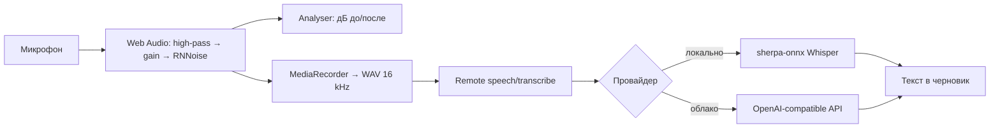

<p align="center">
  
</p>

<h1 align="center">Voice Audio Rus</h1>

<p align="center">
  Голосовой ввод для <a href="https://github.com/deepseek-ai/deepseek-harness">DeepSeek Harness</a>
  с локальным Whisper. <b>Русский язык — приоритет</b>: распознавание, шумоподавление,
  тест микрофона и сравнение движков.
</p>

<p align="center">
  
  
  
  
  
</p>

<p align="center">
  <a href="#быстрый-старт">Установка</a>
  ·
  <a href="docs/local-stt-options.md">Сравнение STT</a>
</p>

---

## Что это

Плагин к DSH (Cordis-бандл: хост-часть + web-клиент), который добавляет диктовку
в композер и полный контроль над звуком. Рассчитан в первую очередь на русскую речь:
по умолчанию включены русский язык и локальная модель Whisper.

- кнопка микрофона в поле ввода → запись → распознавание → вставка текста
  с проверкой ревизии черновика;
- **локальные модели Whisper** (tiny/base/small) через `sherpa-onnx`, уже входящий в DSH —
  скачивание одной кнопкой, без Python и компиляторов;
- **шумоподавление**: RNNoise (WASM), обрезной фильтр, шумовой гейт, AGC;
- **живой тест микрофона**: дБ до и после подавления, калибровка шумового порога;
- **сравнение провайдеров**: одна запись — все движки распознают её независимо;
- push-to-talk, авто-стоп по тишине, авто-пунктуация, словарь замен, история и экспорт.

## Возможности

| | |
|---|---|
| 🎙 **Диктовка** | кнопка в композере, таймер, уровень, отмена/повтор, вставка в черновик |
| 🇷🇺 **Русский** | `ru` по умолчанию, автоопределение языка, локальная модель без облака |
| 🔊 **Шумоподавление** | RNNoise с регулировкой силы, high-pass, гейт, AGC, входное усиление |
| 📈 **Тест микрофона** | уровень «до» и «после» обработки, дБ, калибровка «Обрезать шум» |
| ⚡ **Push-to-talk** | удержание/переключение, запись сочетания клавиш |
| 🤫 **VAD** | авто-стоп по тишине с настраиваемой паузой и порогом |
| 📝 **Текст** | авто-пунктуация, удаление заиканий, словарь «услышано → вставить» |
| 🕘 **История** | последние диктовки, копирование/вставка, экспорт в `.md/.txt/.json` |
| 🧪 **Сравнение** | один WAV → все провайдеры, с задержкой и текстом каждого |

## Быстрый старт

Одна команда из корня репозитория. Скрипт сам найдёт `dsh`, угадает профиль
(настольное приложение → `desktop`, иначе `web`), поставит пакет ссылкой на эту папку
и добавит бандл в `dsh.profile.bundles`.

**Windows (PowerShell):**

```powershell
powershell -ExecutionPolicy Bypass -File .\install.ps1
# в PowerShell 7 то же самое: pwsh -File .\install.ps1
```

**macOS / Linux:**

```bash
./install.sh
```

| PowerShell | shell | Что делает |
|---|---|---|
| `-Profile web` | `--profile web` | другой профиль (`desktop`, `web`, свой) |
| `-Copy` | `--copy` | копировать файлы вместо симлинка (как в релизе) |
| `-Uninstall` | `--uninstall` | убрать плагин из профиля |
| `-Dsh <path>` | `--dsh <path>` | явный путь к `dsh` |
| `-DryRun` | `--dry-run` | показать план и ничего не менять |

Перезапустите DSH (правка клиента подхватывается и по `Ctrl+R`), откройте
**Плагины → Voice Audio Rus** и нажмите **«Скачать все модели»** — загрузка
модели начнётся с прогресс-баром.

<details>
<summary>Вручную, без скрипта</summary>

```powershell
# настольная версия
dsh plugin --profile desktop add "link:D:\path\to\voice-audio-rus\plugin"
# web-версия
dsh plugin --profile web add "link:D:\path\to\voice-audio-rus\plugin"
```

Затем убедитесь, что имя `dsh-plugin-voice-studio` есть в `dsh.profile.bundles`
в `~/.dsh/profiles/<профиль>/package.json` (страница **Plugins** делает это сама,
ручной `dsh plugin add` — нет). Для macOS/Linux путь указывается в POSIX-виде:
`link:/Users/you/voice-audio-rus/plugin`.

</details>

## Локальные модели

| Провайдер | Загрузка | Качество ru | Когда выбирать |
|---|---|---|---|
| Whisper TINY | ≈ 100 МБ | базовое | быстрый старт, короткие команды |
| **Whisper BASE** | ≈ 155 МБ | хорошее | **по умолчанию**, баланс |
| Whisper SMALL | ≈ 360 МБ | очень хорошее | максимум качества офлайн |
| Облако (опция) | 0 | зависит от модели | максимальная точность, ключ на хосте |

Модели качаются один раз в `%USERPROFILE%\.dsh\speech-to-text\whisper\<модель>`
(Hugging Face или зеркало hf-mirror). Сравнение движков и альтернативы
(Vosk, GigaAM, Silero) — в [docs/local-stt-options.md](docs/local-stt-options.md).

## Архитектура



## Настройки

- **Модель распознавания** — провайдер, статус, прогресс загрузки, подготовка.
- **Микрофон** — устройство, тест с двумя измерителями, одна кнопка шумоподавления.
- **Шумоподавление и обработка** — RNNoise (сила), high-pass, гейт, AGC, лимитер.
- **Тишина и клавиши** — авто-стоп, порог, push-to-talk.
- **Текст** — пунктуация, заикания, словарь замен.
- **Распознавание** — провайдер, язык, подготовка модели.
- **Сравнение распознавания** — запись и прогон по всем готовым движкам.
- **История** — список, вставка, экспорт.

## Облачный провайдер

Настраивается прямо в плагине: **Плагины → Voice Audio Rus → «Облачный провайдер»**:

- **Base URL** — `https://api.openai.com/v1` или адрес своего shim-сервера;
- **Модель** — `whisper-1`, `gpt-4o-transcribe` или имя модели на вашем сервере;
- **Ссылка на ключ** — имя записи в хранилище (по умолчанию `OPENAI_API_KEY`);
- **Ключ API** — сохраняется в защищённом хранилище DSH (credentials). В конфиг попадает
  только имя ссылки, значение никогда не возвращается в интерфейс и не пишется в логи.

Параметры применяются сразу, без перезапуска. Резервный путь — переменная окружения с тем
же именем (`[Environment]::SetEnvironmentVariable('OPENAI_API_KEY', 'sk-...', 'User')`).

## Разработка

```powershell
node tools\build.mjs        # client.js из src/client (esbuild)
node tools\whisper-test.mjs # провайдер Whisper с фейковым sherpa
node tools\unit-test.mjs    # текст, WAV, DSP
node tools\smoke-client.mjs # загрузчик + SSR-рендер слотов
```

Структура:

```
plugin/
  index.js            # хост: регистрация провайдеров
  whisper-local.js    # локальный Whisper (скачивание, sherpa-onnx)
  client.js           # собранный клиент
  cordis.patch.yml    # строки профиля
  src/client/         # UI, аудио-конвейер, настройки
  assets/             # RNNoise wasm + worklet
docs/                 # web-страница, сравнение STT и проверки
tools/                # сборка и тесты
```

## Приватность

- Аудио живёт в памяти вкладки и в запросе к выбранному провайдеру.
- Локальные модели обрабатывают звук на машине хоста, без сети после загрузки.
- История хранится в `localStorage` и очищается в настройках.

## Ограничения

- Локальный Whisper не потоковый: распознаётся запись целиком (до 5 минут).
- На слабом CPU `small` может быть медленнее реального времени.
- Не включайте одновременно официальный `dsh-experimental-voice-input-bundle` —
  он вставляет те же строки службы распознавания.

## Лицензия

MIT — см. [LICENSE](LICENSE). Сторонние компоненты и лицензии —
[plugin/THIRD_PARTY_NOTICES.md](plugin/THIRD_PARTY_NOTICES.md).
